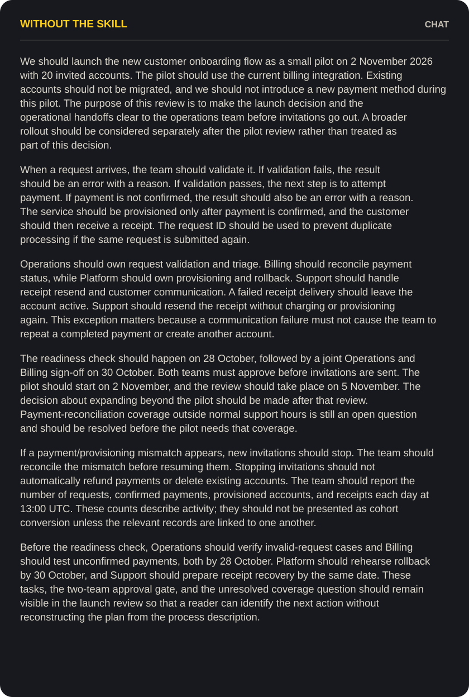
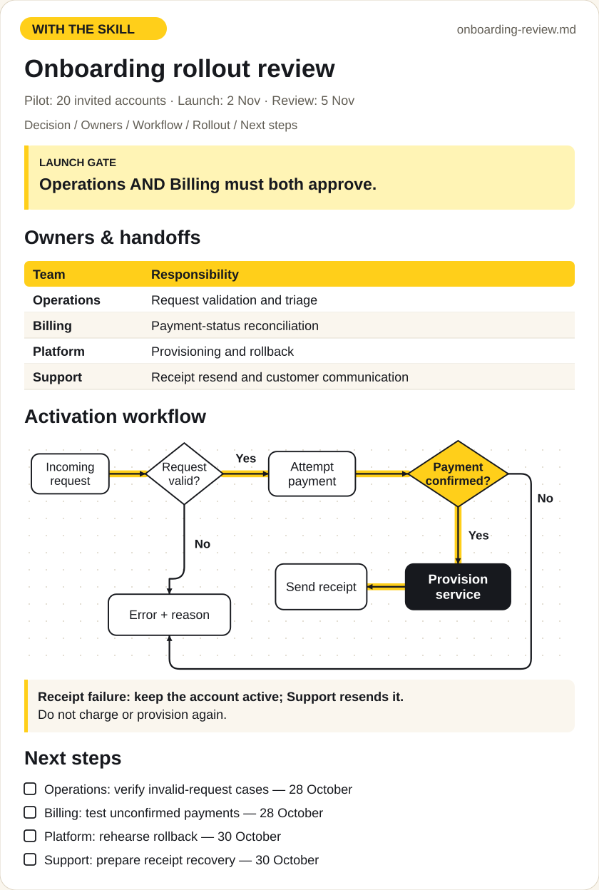

# Rich Markdown First

### Readable answers. By default.

Your agent gives you a long answer in chat. The details are there; the
structure is yours to reconstruct.

Asking “make it readable” after every response adds another task.
**Rich Markdown First** gives the agent a presentation habit: choose a useful
structure while preparing the first answer.

Tables for choices. Diagrams for processes. Callouts for conditions. A document
when the answer needs room. The result adapts to where you read it.

## Add it to your agent

```sh
npx skills add xronocode/rich-md-first
```

<table>
  <tr>
    <th>Without the skill</th>
    <th>With the skill</th>
  </tr>
  <tr>
    <td><a href="assets/plain-reply.svg"></a></td>
    <td><a href="assets/structured-review.svg"></a></td>
  </tr>
</table>

*Same brief. Two illustrative presentations. Click either preview to enlarge.*

<details>
<summary>Read the full example and shared brief</summary>

- [Shared brief](examples/document/brief.md)
- [Plain reply](examples/document/before.md)
- [Structured document](examples/document/after.md)
- [Full visual comparison](assets/before-after.svg)

</details>

Enable the skill in your agent, then ask your usual question:

```text
Prepare a rollout review for this onboarding flow.
Explain the decision, ownership, launch gates, risks, and next steps.
```

The skill is a set of Markdown instructions in the
[Agent Skills format](https://agentskills.io/specification).
It works with the visualization tools available in your environment:
Markdown previews, diagram and chart renderers, or interactive visuals.
The output adapts to what your environment supports.

If you run your agent from a CLI without a suitable document viewer, we
recommend [Mark](https://mark.xronocode.com) — our **free, open-source Markdown
editor for macOS and Windows**. Read tables, diagrams, and math as a finished
page, and watch the document update as your agent writes.
Mark and this skill are both by [@xronocode](https://github.com/xronocode).

## Get to the part that matters

| When you need to… | The agent prepares… | So you can… |
|---|---|---|
| Compare options | A table with the same criteria for each option | See the trade-offs side by side |
| Explain a branching process | A flowchart with conditions and exceptions | Follow each path without reconstructing it from paragraphs |
| Share a plan or report | A structured Markdown document with useful headings, tables, or charts | Give your team a draft they can read and review |

## A presentation habit for your agent

The instructions apply while the agent composes an answer. It chooses a form
for the reader's question, preserves the source facts, and adapts to the
destination. You can ask about the work itself instead of requesting a separate
formatting pass. Small answers stay short.

The first choice is whether a visual helps at all. A fact can stay a sentence;
a simple sequence can stay a list. A table, diagram, or chart earns its place
when it makes the comparison, relationships, or pattern easier to understand.

In a terminal, brief updates stay in plain text. A Mermaid code block is diagram
source; the skill uses it in a compatible document or preview, with a readable
summary in the conversation. It does not turn every status message into a table
or flowchart.

## See the inputs and results

- [Read the full rollout review](examples/document/brief.md) — one brief, a long plain reply, and a structured document.
- [Explain the onboarding workflow](examples/workflow.md) — a smaller example of conditions and failure paths.
- [Compare deployment options](examples/comparison.md) — the same criteria, side by side.
- [Report monthly activity](examples/data.md) — show the counts without inventing a conversion funnel.

All examples are illustrative. They are checked-in demonstrations, not a
benchmark of every agent or model.

## Try it on your own work

```text
Explain this onboarding process to a new teammate.
```

```text
Prepare this monthly report for our leadership review.
Preserve the units and distinguish what the data shows from what it cannot tell us.
```

## Read it where you work

Choose GitHub, your editor, or the current chat. The skill follows your chosen
destination and its supported features. If no suitable renderer is available,
it keeps the explanation readable with text or supported tables.

For manual installation, copy the entire `skills/rich-md-first` folder to:

| Agent | Personal destination |
|---|---|
| Codex | `~/.agents/skills/rich-md-first/` |
| Claude Code | `~/.claude/skills/rich-md-first/` |

See the official [Codex](https://learn.chatgpt.com/docs/build-skills) and
[Claude Code](https://code.claude.com/docs/en/skills) installation guidance.
Skill selection depends on your host and settings. Agents with automatic skill
discovery can select it from the task; hosts that require an explicit choice
can invoke it by name.

## Validation and development

The package includes reproducible checks for metadata, local references,
example syntax, and illustration data. See [what is checked and what is not](docs/validation.md).

```sh
npm ci --ignore-scripts
npm run check
```

These dependencies are for repository checks; installing the skill copies its
instruction files. Agent behavior depends on the host and model.

## License

[MIT](LICENSE).
