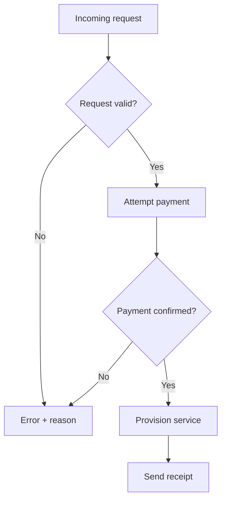

# Onboarding rollout review

**Pilot:** 20 invited accounts · **Launch:** 2 November 2026 · **Review:** 5 November.

Illustrative scenario. Read the [shared brief](brief.md) and [plain reply](before.md).

**Contents:** [Decision](#decision) · [Owners](#owners) · [Workflow](#activation-workflow) · [Rollout](#rollout-and-monitoring) · [Next steps](#next-steps).

## Decision

Launch a limited pilot using the current billing integration. Existing-account
migration and new payment methods are outside its scope. Decide on expansion
after the pilot review.

> [!IMPORTANT]
> **Launch gate:** Operations **and** Billing must both approve before invitations.

## Owners

| Team | Responsibility |
|---|---|
| Operations | Request validation and triage |
| Billing | Payment-status reconciliation |
| Platform | Provisioning and rollback |
| Support | Receipt resend and customer communication |

## Activation workflow

**Provision only after successful validation and confirmed payment.**

Use the request ID to prevent duplicate processing when a request is resubmitted.

> [!WARNING]
> **Receipt failure:** keep the account active. Support resends the receipt;
> do not charge or provision again.

## Rollout and monitoring

| Date, 2026 | Gate or event |
|---|---|
| 28 October | Readiness check |
| 30 October | Joint Operations and Billing sign-off |
| 2 November | Pilot starts |
| 5 November | Pilot review; consider expansion separately |

If a payment/provisioning mismatch appears, stop new invitations and reconcile
it before resuming. This does not automatically refund payments or delete accounts.

At **13:00 UTC daily**, report request, confirmed-payment, provisioned-account,
and receipt counts. These are activity counts; claim cohort conversion only
when the records are linked.

## Next steps

- [ ] Operations: verify invalid-request cases — **28 October**.
- [ ] Billing: test unconfirmed payments — **28 October**.
- [ ] Platform: rehearse rollback — **30 October**.
- [ ] Support: prepare receipt recovery — **30 October**.

## Open decisions

- Expand beyond the pilot after the 5 November review?
- Who covers payment reconciliation outside normal support hours?
