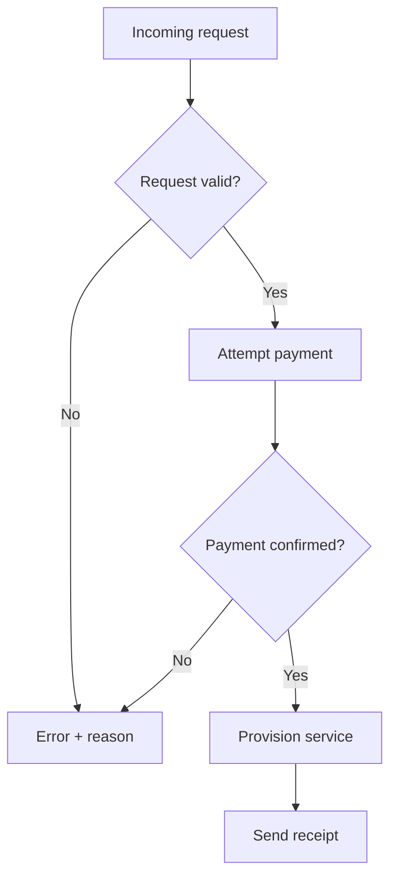

# Follow an onboarding workflow

Illustrative scenario.

## Source

When a request arrives, validate it. If validation fails, return an error with
a reason. If validation passes, attempt payment. If payment fails, return an
error with a reason. Provision the service only after payment succeeds.
Then send the customer a receipt.

## Structured result

**Provision only after successful validation and confirmed payment.**

Both failure paths preserve the reason. Receipt delivery follows provisioning.
