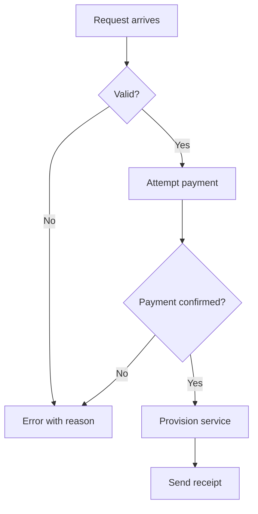
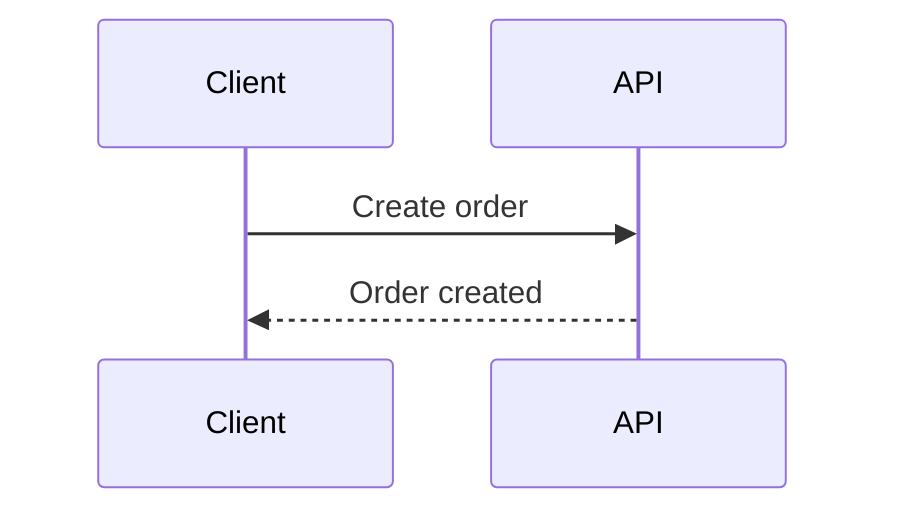
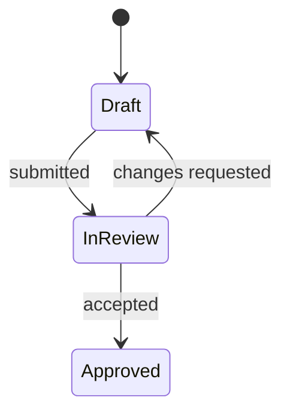
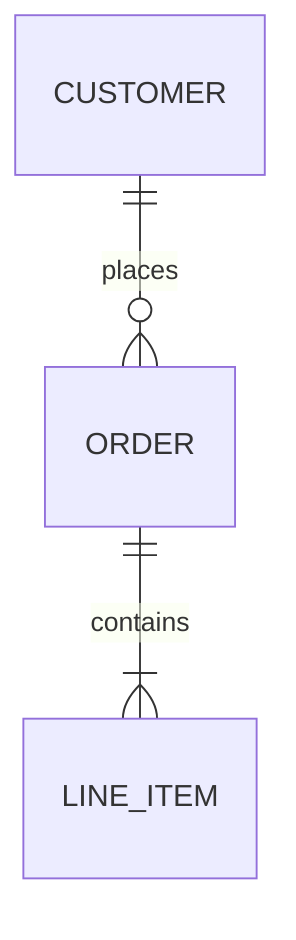
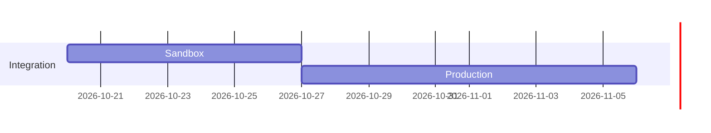
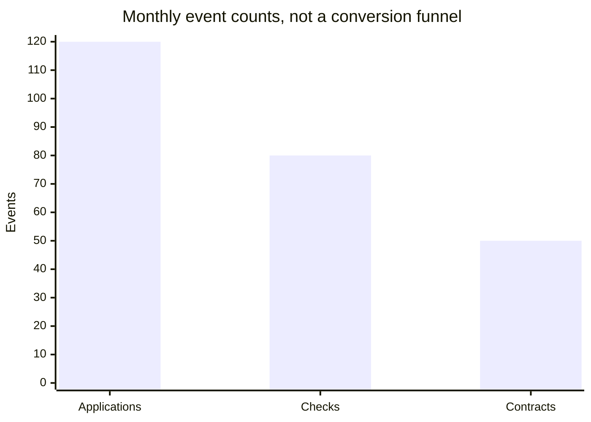
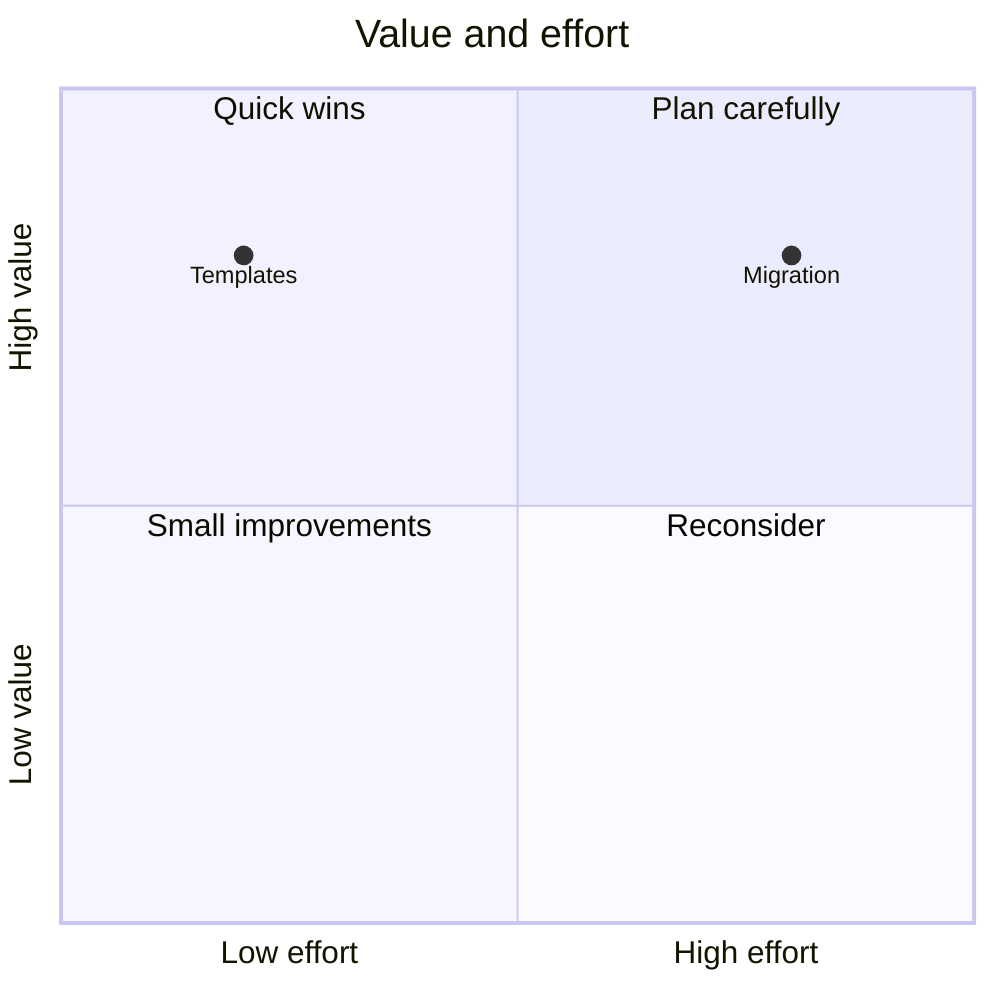

# Choose a form that answers the question

## Quantities

| Question | Form | Keep honest |
|---|---|---|
| Which category is larger? | Bar chart | Start the quantitative bar axis at zero; retain natural category order when meaningful |
| How does it change over time? | Line chart | Show time, units, and period; distinguish missing values from zero |
| What share of a whole? | Bar or a small pie | A pie needs parts of one whole; use bars for close comparisons |
| How are two measurements related? | Scatter plot | Association does not establish causation |
| How are values distributed? | Histogram or box plot | Show units and meaningful bins or summary definitions |
| Where does a quantity move? | Sankey | Require real transitions and compatible totals; independent counts are not flows |
| What should we prioritize? | Two-axis quadrant | Define both axes and their direction; low effort/high value must be placed accordingly |

Use an available charting tool that supports the necessary scales and labels.
Mermaid `xychart-beta` is useful for a small chart when supported. Extended
formats such as Vega-Lite require a compatible destination and validation.

## Structures

| Content | Form | Boundary |
|---|---|---|
| Process, branching, static links | `flowchart` | Static dependencies do not imply temporal message order |
| Messages in a known scenario | `sequenceDiagram` | Do not invent an interaction sequence from an architecture list |
| One object's lifecycle | `stateDiagram-v2` | Separate independent lifecycles |
| Data entities and cardinality | `erDiagram` | Preserve relationship constraints |
| Types and inheritance | `classDiagram` | Use ER for a purely relational data model |
| Architecture at a C4 level | `C4Context`, `C4Container`, or `C4Component` | Choose the actual level; code-level views need a suitable separate representation |
| Milestones or dated work | `timeline` or `gantt` | A calendar plan needs actual dates and dependencies |
| Ideas or taxonomy | `mindmap` | Branch size does not represent quantity |

Rare or beta diagram types depend on the target renderer. Prefer a supported
flowchart or a readable explanation when their rendering cannot be established.

## Illustrative syntax

These examples exercise syntax. They do not establish support in every host.

### Branching process

### Known message order

### Lifecycle

### Data relationships

### Dated plan

### Independent monthly counts

### Value and effort

## Visual checks

Keep labels readable at the document's width. Choose LR or TD based on the
actual labels and connections. Use color to direct attention to a meaningful
condition or comparison, and keep the important meaning available in text.
